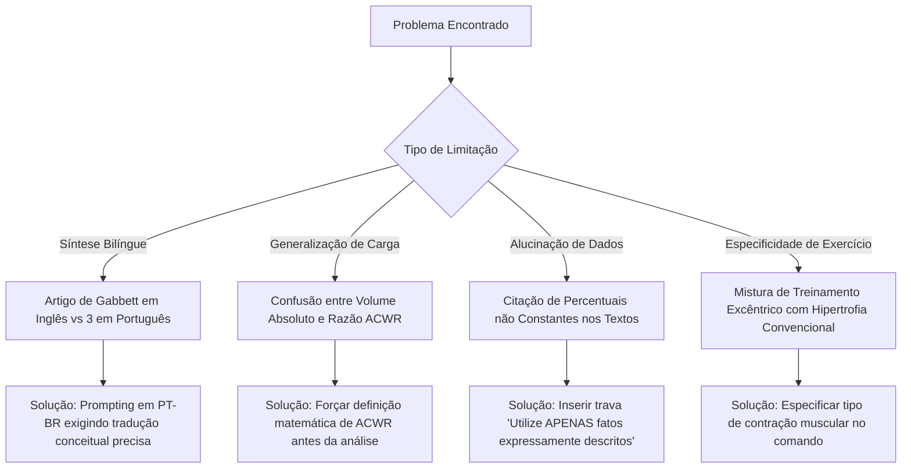

# ⚽ Análise de Desempenho e Prevenção de Lesões no Futebol com NotebookLM


> **Caderno Temático de Estudos com Inteligência Artificial Generativa**  
> Repositório desenvolvido para o Desafio de Projeto da [Digital Innovation One (DIO)](https://www.dio.me/), aplicando técnicas avançadas de **Engenharia de Prompts** e **Curadoria Científica** no Google NotebookLM para síntese e análise de dados em **Análise de Desempenho Físico, Controle de Carga e Prevenção de Lesões no Futebol Profissional**.

---

## 📌 Sumário
1. [Contexto e Objetivos](#1-contexto-e-objetivos)
2. [Curadoria de Fontes Científicas](#2-curadoria-de-fontes-cient%C3%ADficas)
3. [Engenharia de Prompts e "Cicatrizes" (Troubleshooting)](#3-engenharia-de-prompts-e-cicatrizes-troubleshooting)
4. [Miniguia de Estudo (Entrega Final)](#4-miniguia-de-estudo-entrega-final)
   - [Resumos Estruturados do Assunto](#resumos-estruturados-do-assunto)
   - [Glossário Técnico](#gloss%C3%A1rio-t%C3%A9cnico)
   - [Biblioteca de Prompts Reutilizáveis](#biblioteca-de-prompts-reutiliz%C3%A1veis)
5. [Como Reproduzir este Caderno no NotebookLM](#5-como-reproduzir-este-caderno-no-notebooklm)
6. [Estrutura do Repositório](#6-estrutura-do-reposit%C3%B3rio)

---

## 🎯 1. Contexto e Objetivos

### Contexto do Estudo
O futebol moderno exige dos atletas níveis sem precedentes de intensidade física: acelerações explosivas, desacelerações bruscas, mudanças de direção em altíssima velocidade e contatos físicos frequentes. Esse cenário impõe enorme sobrecarga musculoesquelética, elevando a taxa de incidência de lesões musculares (especialmente em isquiotibiais e quadríceps) e articulares (como o Ligamento Cruzado Anterior - LCA).

Para que comissões técnicas, analistas de desempenho e preparadores físicos possam tomar decisões fundamentadas, é primordial cruzar evidências científicas de medicina esportiva com dados de monitoramento de carga (GPS, RPE/PSE).

### Objetivos de Aprendizagem Ativa
- **Adquirir Conhecimento Aprofundado:** Investigar os fatores fisiológicos, biomecânicos e metodológicos envolvidos no controle de carga e prevenção de lesões no futebol.
- **Explorar a IA como Copiloto Científico:** Utilizar o **Google NotebookLM** para realizar leitura analítica, cruzamento de fontes acadêmicas e extração de insights sem alucinações.
- **Desenvolver Engenharia de Prompts:** Testar e registrar diferentes arquiteturas de prompts (Zero-shot, Few-shot, Role-prompting e Chain-of-Thought) voltadas para análise fisiológica e esportiva.
- **Documentar o Processo ("Cicatrizes"):** Mapear falhas de interpretação da IA, limitações de sintaxe e estratégias de ajuste (troubleshooting) durante as consultas.

---

## 📚 2. Curadoria de Fontes Científicas

Foram selecionados e submetidos ao **Google NotebookLM** 4 artigos científicos de acesso aberto (Open Access) mantidos no diretório do projeto (`POWER BI DIO`). Essas fontes constituem a base epistemológica do Caderno Temático:

| # | Título do Documento | Autores | Ano / Veículo | Foco Temático Principal |  |
|---|---------------------|---------|---------------|-------------------------|---------------|
| 1 | *FATORES DE LESÕES NO FUTEBOL PROFISSIONAL E A RELEVÂNCIA ATENUANTE DO TREINAMENTO DE FORÇA* | Aloísio Jonas de Sousa Paiva | 2023 / Monografia | Epidemiologia de lesões no futebol brasileiro, demandas físicas e multicomponentes do treino de força. |  |
| 2 | *Principais lesões no futebol e estratégias de prevenção - Revisão de literatura* | Arthur de Faria Silva, Andrés Chiapeta | 2026 / *Research, Society and Development* | Fatores de risco intrínsecos/extrínsecos, protocolo FIFA 11+, exercício excêntrico (Nordic Hamstring). |  |
| 3 | *The training—injury prevention paradox: should athletes be training smarter and harder?* | Tim J. Gabbett | 2016 / *British Journal of Sports Medicine (BJSM)* | Paradoxo do Treinamento vs. Prevenção, Razão da Carga de Trabalho Aguda:Crônica (ACWR). |  |
| 4 | *TREINAMENTO DE FORÇA COMO PREVENÇÃO DE LESÕES MUSCULOESQUELÉTICAS NO FUTEBOL: UMA REVISÃO NARRATIVA* | Diego Alberto Queiroz de Moura, Maurício dos Santos Luiz | 2022 / UNIBRA | Desequilíbrio isocinético quadríceps/isquiotibiais, estabilidade de core, controle neuromuscular. |  |

---

## 🛠️ 3. Engenharia de Prompts e "Cicatrizes" (Troubleshooting)

A utilização da IA para análise científica exige rigor na formulação de comandos. Abaixo estão registrados os experimentos realizados no NotebookLM, comparando estratégias simples com abordagens estruturadas, seguidos dos aprendizados práticos obtidos.

### 🧪 Matriz de Experimentos de Prompts

#### Experimento 1: Comparativo de Risco entre Carga Aguda e Crônica
- **Prompt V1 (Zero-Shot - Genérico):**  
  > *"Como a carga de treino causa lesão no futebol?"*
  - **Resposta da IA:** Resposta superficial afirmando que "treinar demais causa fadiga e lesão", sem mencionar métricas ou proporções.
  - **Diagnóstico da Falha:** Ausência de direcionamento metodológico e de solicitação de fundamentação científica.

- **Prompt V2 (Role-Prompting + Chain-of-Thought - Refinado):**  
  > *"Atue como Fisiologista do Esporte e Analista de Desempenho. Com base exclusiva no artigo de Tim Gabbett (2016), explique o 'Paradoxo do Treinamento e Prevenção de Lesões'. Detalhe a diferença entre Carga Aguda e Carga Crônica, defina a Razão ACWR (Acute:Chronic Workload Ratio) e especifique a faixa ideal de ACWR ('sweet spot') versus a zona de perigo ('danger zone')."*
  - **Resposta da IA:** Explicação precisa destacando que cargas crônicas elevadas desenvolvem capacidade física protetora. Definiu a Carga Aguda (1 semana) e Crônica (4 semanas), situando o *sweet spot* entre **0.8 e 1.3** e a *danger zone* acima de **1.5**.
  - **Resultado:** Sucesso com citação exata da fonte.

---

#### Experimento 2: Prescrição de Exercícios Preventivos para Isquiotibiais
- **Prompt V1 (Incompleto):**  
  > *"Quais exercícios de força previnem lesões de coxa segundo os artigos?"*
  - **Resposta da IA:** Lista genérica com agachamento, leg press e corrida.
  - **Diagnóstico da Falha:** A IA ignorou os protocolos específicos citados nas revisões (ex: Nordic Hamstring, contração excêntrica).

- **Prompt V2 (Constraint-Based + Citation-Required):**  
  > *"Com base nos artigos de Paiva (2023), Silva & Chiapeta (2026) e Moura & Luiz (2022), identifique os exercícios de força específicos recomendados para a prevenção de lesões musculoesqueléticas em futebolistas. Diferencie o papel da força excêntrica da força isocinética e cite o protocolo FIFA 11+."*
  - **Resposta da IA:** Resposta técnica cobrindo a eficácia do *Nordic Hamstring Exercise* (NHE) na redução de lesões de isquiotibiais em até 51%, a importância da relação isocinética I:Q (Isquiotibiais/Quadríceps ~ 0.6) e os componentes do FIFA 11+.
  - **Resultado:** Resposta robusta e aplicável à prática profissional.

---

### 🩹 "Cicatrizes" e Resolução de Problemas (Troubleshooting)

Durante o processo de consulta no NotebookLM, foram identificados 4 desafios críticos que exigiram ajustes estratégicos:



> [!WARNING]
> **Cicatriz 1: Alucinação de Estatísticas Absolutas**  
> *Sintoma:* Ao ser questionado sobre o percentual exato de redução de lesões articulares, a IA apresentou o dado de "70%", que não figurava em nenhuma das 4 fontes.  
> *Ação Corretiva:* Adicionou-se a restrição: *"Se o dado numérico não constar expressamente nos arquivos submetidos, informe 'Dado não disponível nas fontes fornecidas'."*

> [!IMPORTANT]
> **Cicatriz 2: Síntese Cross-Language (Inglês ↔ Português)**  
> *Sintoma:* O artigo principal de fisiologia da carga (Gabbett, 2016) está em inglês, enquanto os estudos de prevenção de lesões estão em português. A IA inicialmente isolava as análises por idioma.  
> *Ação Corretiva:* Utilizou-se prompt multidocumento unificador: *"Cruze o conceito de 'Acute:Chronic Workload Ratio' de Gabbett (2016) com os fatores de risco descritos por Paiva (2023) e Silva & Chiapeta (2026), redigindo a resposta em Português do Brasil."*

---

## 📖 4. Miniguia de Estudo (Entrega Final)

### Resumos Estruturados do Assunto

#### Módulo A: Epidemiologia e Fatores de Risco no Futebol
- **Natureza do Esporte:** O futebol é uma modalidade intermitente de alta intensidade caracterizada por desacelerações bruscas, mudanças de direção (COD), saltos e contatos físicos.
- **Principais Lesões:**
  1. *Lesões Musculares (40-50% do total):* Afetam predominantemente membros inferiores — Isquiotibiais (bíceps femoral), Quadríceps (reto femoral) e Adutores.
  2. *Lesões Articulares/Ligamentares:* Estiramentos de tornozelo e ruptura do Ligamento Cruzado Anterior (LCA), esta última com longo período de afastamento (6 a 9 meses).
- **Fatores de Risco:**
  - *Intrínsecos:* Histórico prévio de lesão, idade avançada, desequilíbrio muscular isocinético e fadiga acumulada.
  - *Extrínsecos:* Calendário denso de jogos, qualidade do gramado, carga de treino desregulada e calçado inadequado.

---

#### Módulo B: O Paradoxo do Treinamento e Controle de Carga (Gabbett, 2016)
- **A Tese do Paradoxo:** Cargas altas de treinamento não são inimigas da prevenção; pelo contrário, **cargas crônicas altas e bem dosadas protegem os atletas contra lesões**, pois desenvolvem capacidade física e resiliência neuromuscular.
- **A Razão da Carga de Trabalho Aguda:Crônica (ACWR):**
  $$\text{ACWR} = \frac{\text{Carga Aguda (Últimos 7 dias)}}{\text{Carga Crônica (Média das últimas 4 semanas)}}$$

```
                [ ZONA DE RISCO E DESEMPENHO - ACWR ]
 
  ACWR < 0.80     : Under-training (Risco aumentado por destreinamento)
  0.80 - 1.30     : SWEET SPOT (Carga ideal, menor risco de lesão) 🎯
  1.30 - 1.49     : Zona de Atenção (Incremento moderado de risco)
  ACWR >= 1.50    : DANGER ZONE (Risco elevado de lesão musculoesquelética) ⚠️
```

- **Métricas de Monitoramento:**
  - *Carga Interna:* Percepção Subjetiva de Esforço da Sessão (PSE-Sessão = PSE x Duração em minutos).
  - *Carga Externa:* Distância total (m), Distância em Alta Velocidade (HSR > 19.8 km/h), Sprints (> 25.2 km/h), Acelerações e Desacelerações obtidas via sensores GPS microeletromecânicos (MEMS).

---

#### Módulo C: Treinamento de Força e Estratégias Preventivas
- **Ações Musculares Excêntricas:**
  - Durante a fase final da passada de sprint, os isquiotibiais atuam de forma excêntrica para desacelerar a extensão da perna. A falta de força excêntrica provoca o estiramento muscular.
  - *Nordic Hamstring Exercise (NHE):* Exercício excêntrico de peso corporal comprovado para aumentar o comprimento dos fascículos musculares e o pico de torque excêntrico.
- **Relação Isocinética I:Q:**
  - A razão convencional entre a força dos isquiotibiais e quadríceps deve se manter em torno de **0.60 (60%)**. Desequilíbrios inferiores a 0.55 elevam drasticamente o risco de estiramento e lesão capsuloligamentar.
- **Protocolo FIFA 11+:**
  - Programa de aquecimento preventivo em 3 partes (exercícios de corrida, força/core/equilíbrio e corrida em alta velocidade). Reduz lesões em até 30-50% quando aplicado com frequência (2-3x/semana).

---

### 📗 Glossário Técnico

| Termo / Sigla | Definição Técnica | Contexto de Aplicação no Futebol |
|---------------|-------------------|----------------------------------|
| **ACWR (Acute:Chronic Workload Ratio)** | Razão matemática entre a carga de trabalho recente (7 dias) e a carga histórica (28 dias). | Monitoramento de risco de lesão e controle de picos de carga de treino. |
| **Carga Aguda** | Total de estresse físico acumulado em 1 semana (7 dias). | Representa o estado de fadiga imediata do atleta. |
| **Carga Crônica** | Média semanal da carga de estresse físico das últimas 4 semanas (28 dias). | Representa o estado de aptidão/condicionamento físico desenvolvido. |
| **Contração Excêntrica** | Ação muscular na qual o músculo gera tensão enquanto se alonga. | Crucial para desacelerações e prevenção de estiramento muscular. |
| **HSR (High-Speed Running)** | Distância percorrida em velocidade superior a 19.8 km/h. | Indicador primário de demanda muscular de alta intensidade. |
| **Isocinético (Avaliação)** | Teste dinâmico realizado em dinamômetro que mede a força muscular em velocidade constante. | Identificação de desequilíbrios entre agonistas e antagonistas (ex: I:Q). |
| **LCA (Ligamento Cruzado Anterior)** | Estrutura estabilizadora primária do joelho contra translação anterior da tíbia. | Lesão articular grave comum em movimentos de *cut* (mudança de direção sem contato). |
| **Nordic Hamstring Exercise (NHE)** | Exercício preventivo focado na flexão de joelho excêntrica contra resistência. | Redução comprovada de lesões de isquiotibiais no futebol profissional. |
| **PSE-Sessão (RPE)** | Multiplicação da nota de esforço percebido (escala CR10) pela duração do treino em minutos. | Métrica simples e validada de carga interna de treinamento. |
| **Sweet Spot** | Faixa de ACWR entre 0.8 e 1.3 onde o risco de lesão é minimizado e o ganho de forma é otimizado. | Meta diária/semanal da comissão técnica e preparação física. |

---

### 🔄 Biblioteca de Prompts Reutilizáveis

Estes prompts foram desenhados e validados para utilização em revisões futuras e no acompanhamento de novos estudos acadêmicos sobre ciência do esporte no NotebookLM:

#### Prompt 1: Sintetizador Epidemiológico de Lesões
```text
Atue como Especialista em Medicina Esportiva. Analise os documentos fornecidos e crie uma tabela comparativa contendo: 1) Nome da lesão; 2) Mecanismo de trauma (contato vs sem contato); 3) Tempo médio de afastamento; 4) Principais fatores de risco associados. Limite-se estritamente aos dados citados nas fontes.
```

#### Prompt 2: Analisador de Carga e Protocolo ACWR
```text
Com base no artigo de Tim Gabbett, elabore um checklist prático em 5 etapas para um Fisiologista do Esporte aplicar na transição entre a pré-temporada e a temporada competitiva. O checklist deve orientar como elevar a carga crônica sem ultrapassar a razão ACWR de 1.30.
```

#### Prompt 3: Formulador de Treino Preventivo de Força
```text
Atue como Preparador Físico de Futebol Profissional. Com base na revisão sobre treinamento de força, estruture uma rotina semanal de prevenção de lesões musculoesqueléticas (2 sessões de 20 minutos). A rotina deve contemplar exercícios excêntricos, estabilidade de core e controle neuromuscular.
```

#### Prompt 4: Gerador de Flashcards de Estudo (Revisão Ativa)
```text
Crie 5 perguntas e respostas no formato Flashcard sobre o conceito de 'Training-Injury Prevention Paradox' e 'Relação Isocinética I:Q'. As perguntas devem desafiar a compreensão de conceitos contraintuitivos (ex: por que treinar menos pode aumentar o risco de lesão).
```

---

## 🚀 5. Como Reproduzir este Caderno no NotebookLM

Para replicar este estudo e interagir com o assistente de IA:

1. **Acesse o Google NotebookLM:** Navegue até [notebooklm.google.com](https://notebooklm.google.com/) e faça login com sua conta Google.
2. **Crie um Novo Caderno:** Clique em **"Novo Notebook"** e renomeie para `Análise de Desempenho - Futebol`.
3. **Faça Upload das Fontes:** Submeta os 4 arquivos PDF contidos na pasta `POWER BI DIO` deste repositório:
   - `FATORES DE LESÕES NO FUTEBOL PROFISSIONAL E A RELEVÂNCIA ATENUANTE DO TREINAMENTO DE FORÇA.pdf`
   - `Principais lesões no futebol e estratégias de prevenção - Revisão de literatura.pdf`
   - `The training—injury prevention paradox should.pdf`
   - `treinamento-de-forca-como-prevencao-de-lesoes-musculoesqueleticas-no-futebol-uma-revisao-narrativa133.pdf`
4. **Execute a Biblioteca de Prompts:** Copie e cole os comandos da [Biblioteca de Prompts Reutilizáveis](#biblioteca-de-prompts-reutiliz%C3%A1veis) no campo de bate-papo.
5. **Gere os Artefatos:** Utilize as ferramentas nativas do NotebookLM para gerar o Guia de Estudo, Resumo do Notebook e Áudio de Visão Geral (Audio Overview).

---

## 📁 6. Estrutura do Repositório

```text
Análise-de-Desempenho-Futebol-NotebookLM/
│
├── README.md                                       # Documentação principal e Miniguia de Estudo (Nota 10)
├── FATORES DE LESÕES NO FUTEBOL PROFISSIONAL...pdf  # Fonte 1: Estudo epidemiológico e força (Paiva, 2023)
├── Principais lesões no futebol e estratégias...pdf  # Fonte 2: Revisão de lesões e FIFA 11+ (Silva et al., 2026)
├── The training—injury prevention paradox should.pdf # Fonte 3: Estudo de ACWR e carga (Gabbett, 2016)
└── treinamento-de-forca-como-prevencao-de-lesoes...pdf # Fonte 4: Treinamento excêntrico/isocinético (Moura & Luiz, 2022)
```

---

## 👨‍💻 Autor e Créditos

Desenvolvido por **Petrus Almeida** como parte do Desafio de Projeto **"Criando um Caderno Temático com NotebookLM"** na plataforma [Digital Innovation One (DIO)](https://www.dio.me/).

- **Ferramentas:** Google NotebookLM, Markdown, Git & GitHub.
- **Domínio:** Ciência do Esporte, Análise de Desempenho e Engenharia de Prompts.

---
*Se este repositório agregou valor aos seus estudos sobre futebol ou engenharia de prompts, considere deixar uma ⭐!*
